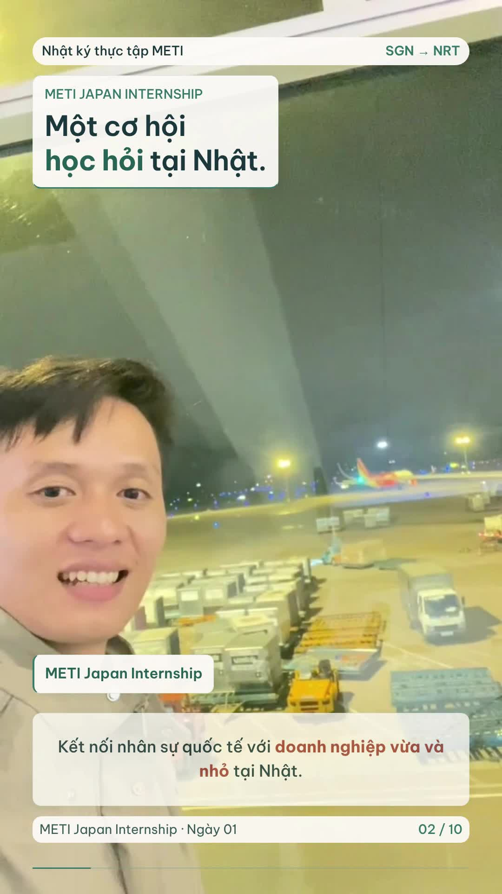
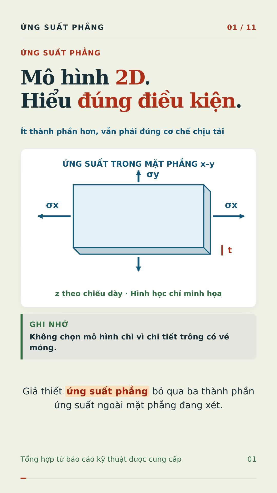
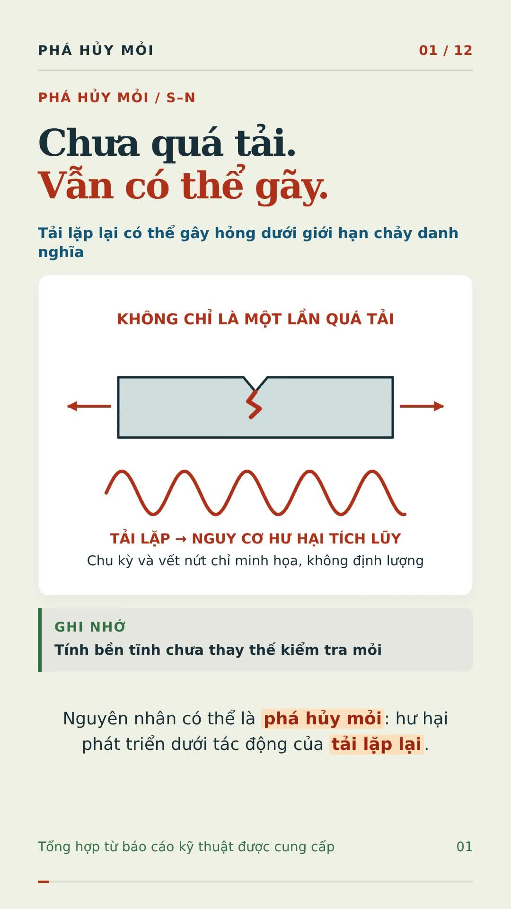
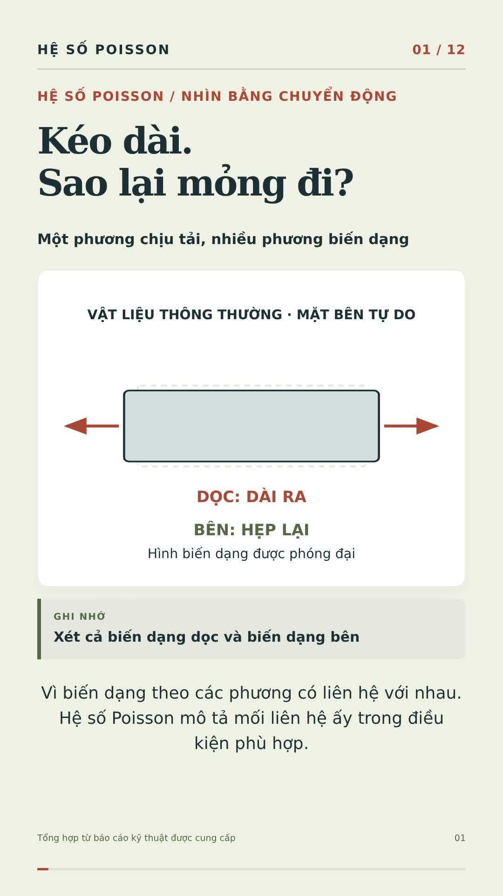
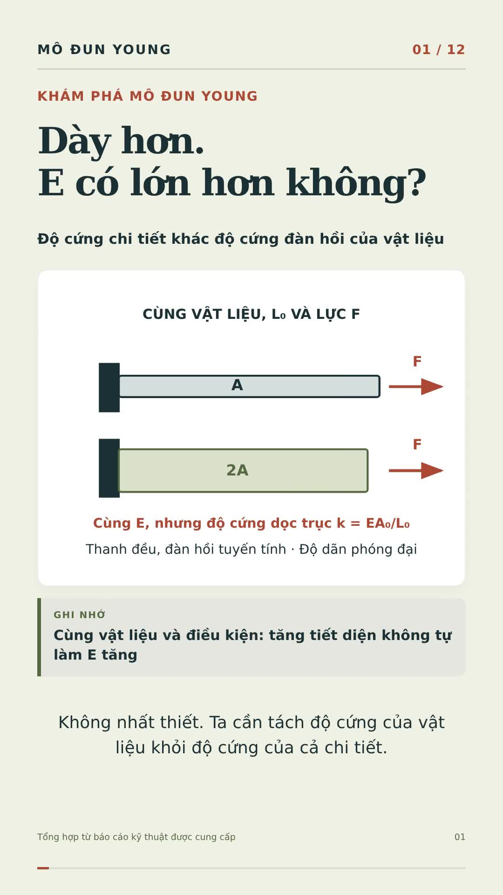
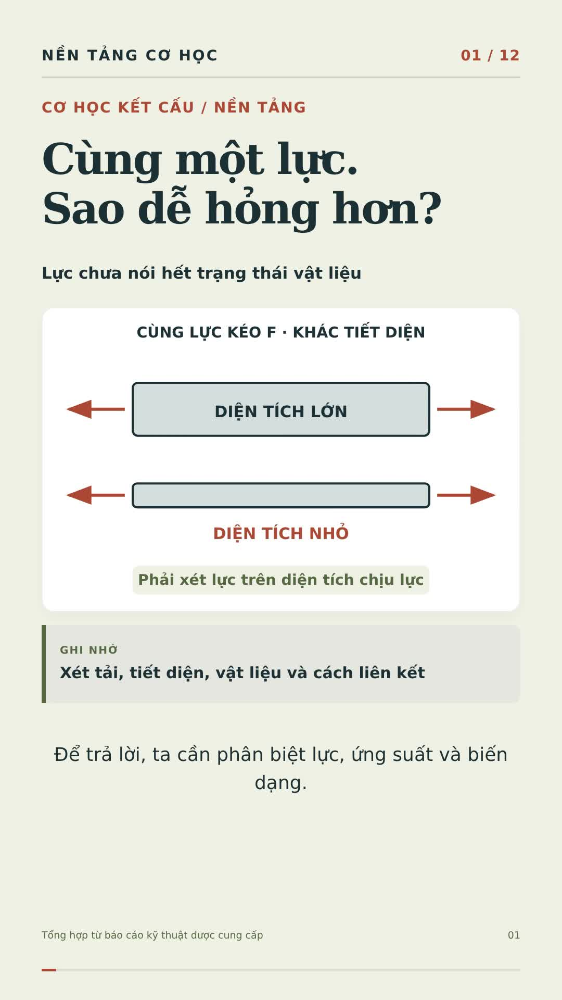

## Kỹ năng tạo video học thuật

Đã lưu quy trình thành **[video-hoc-thuat](.agents/skills/video-hoc-thuat/SKILL.md)** để dùng lại phong cách video trong kho: sơ đồ chuyển động, giọng Việt, phụ đề và **từ khóa đậm, nhấn màu rõ**.

**[TẢI GÓI KỸ NĂNG — ZIP](https://github.com/nguyennguyenengmechanics-svg/Bien/raw/refs/heads/main/skills/video-hoc-thuat.zip)** · [Cách dùng và cài ở môi trường khác](skills/README.md)

Cách gọi: **“Dùng $video-hoc-thuat để tạo video học thuật từ tài liệu này.”** Khi làm trong kho Bien, AGENTS.md cũng định tuyến các yêu cầu tạo video học thuật đến kỹ năng.

---

## Video mới: METI Japan Internship — Thiết kế v2

**[TẢI VLOG METI — BẢN V2](https://github.com/nguyennguyenengmechanics-svg/Bien/raw/refs/heads/main/videos/meti-japan-internship/meti-japan-internship-ngay-1-v2.mp4)**

Bản thiết kế mới dùng **Be Vietnam Pro, nền kem sáng và xanh ngọc**, giảm các khối nền đậm để cảnh quay thoáng hơn. Nhật ký tham gia METI Japan Internship, từ Tân Sơn Nhất đến Narita rồi gặp các bạn đến từ nhiều nơi. Video dọc 1080 × 1920, 30 fps, dài khoảng 1 phút 31 giây; dựng từ cảnh quay thật và ảnh của người dùng, có lời Việt tổng hợp, nhạc nền và phụ đề nhấn từ khóa. Giữ trình tự part 1 → part 2, phân biệt Arrivals với Domestic/Transit, dùng thẻ cho phần không ghi hình và nhắc Visit Japan Web bằng hình nhỏ. Các mốc đã xác nhận: 00:25 giờ Việt Nam → 08:00 giờ Nhật Bản.

- [Caption TikTok](videos/meti-japan-internship/CAPTION-TIKTOK.txt)
- [Phụ đề tiếng Việt](videos/meti-japan-internship/phu-de.vi.srt)
- [Lời dẫn](videos/meti-japan-internship/loi-dan.txt)
- [Tải mã nguồn v2 — ZIP](https://github.com/nguyennguyenengmechanics-svg/Bien/raw/refs/heads/main/videos/meti-japan-internship/ma-nguon-video-v2.zip)
- [Nguồn và ghi chú v2](videos/meti-japan-internship/GHI-CHU-v2.txt)
- [Báo cáo kiểm tra v2](videos/meti-japan-internship/KIEM-TRA-v2.md)

[Tải bản v1 để so sánh](https://github.com/nguyennguyenengmechanics-svg/Bien/raw/refs/heads/main/videos/meti-japan-internship/meti-japan-internship-ngay-1.mp4)

Nếu trình duyệt mở video, chọn **⋮ → Tải xuống**.

---

## Video: Ứng suất phẳng trong thiết kế cơ khí

**[TẢI VIDEO ỨNG SUẤT PHẲNG — MP4](https://github.com/nguyennguyenengmechanics-svg/Bien/raw/refs/heads/main/videos/ung-suat-phang/ung-suat-phang.mp4)**

Video dọc 1080 × 1920, 30 fps, dài khoảng 4 phút 9 giây. Giải thích ba thành phần ứng suất còn lại, mặt tự do và điều kiện áp dụng; phân biệt ứng suất phẳng với biến dạng phẳng qua ví dụ Poisson. Minh họa tấm có lỗ, uốn tấm, bình trụ thành mỏng và chân răng; có cây chọn 2D/tấm-vỏ/3D. Từ khóa đậm tô màu, giọng Việt tổng hợp, phụ đề và nhạc nền. Các ví dụ số là giả định.

- [Phụ đề tiếng Việt](videos/ung-suat-phang/phu-de.vi.srt)
- [Lời dẫn](videos/ung-suat-phang/loi-dan.txt)
- [Caption TikTok](videos/ung-suat-phang/CAPTION-TIKTOK.txt)
- [Tải mã nguồn chỉnh sửa — ZIP](https://github.com/nguyennguyenengmechanics-svg/Bien/raw/refs/heads/main/videos/ung-suat-phang/ma-nguon-video.zip)
- [Giả thiết, hiệu chỉnh kỹ thuật, nguồn và giấy phép](videos/ung-suat-phang/GHI-CHU.txt)
- [Báo cáo kiểm tra](videos/ung-suat-phang/KIEM-TRA.md)

Nếu trình duyệt mở video, chọn **⋮ → Tải xuống**.

---

## Video: Các thuyết phá hủy trong cơ học vật liệu

**[TẢI VIDEO CÁC THUYẾT PHÁ HỦY — MP4](https://github.com/nguyennguyenengmechanics-svg/Bien/raw/refs/heads/main/videos/cac-thuyet-pha-huy/cac-thuyet-pha-huy.mp4)**

Video dọc 1080 × 1920, 30 fps, dài khoảng 4 phút 31 giây. Phân biệt chảy dẻo và nứt gãy; tách thủy tĩnh–lệch; so sánh Tresca, von Mises bằng ví dụ số và đồ thị lục giác–elip. Giải thích chênh lệch 15,5% ở cắt thuần túy, giới thiệu Rankine, Coulomb–Mohr và Mohr sửa đổi trong phạm vi phù hợp. Có cây lựa chọn, từ khóa in đậm tô màu, lời Việt tổng hợp, phụ đề và nhạc nền.

- [Phụ đề tiếng Việt](videos/cac-thuyet-pha-huy/phu-de.vi.srt)
- [Lời dẫn](videos/cac-thuyet-pha-huy/loi-dan.txt)
- [Caption TikTok](videos/cac-thuyet-pha-huy/CAPTION-TIKTOK.txt)
- [Tải mã nguồn chỉnh sửa — ZIP](https://github.com/nguyennguyenengmechanics-svg/Bien/raw/refs/heads/main/videos/cac-thuyet-pha-huy/ma-nguon-video.zip)
- [Giả thiết, hiệu chỉnh kỹ thuật, nguồn và giấy phép](videos/cac-thuyet-pha-huy/GHI-CHU.txt)
- [Báo cáo kiểm tra](videos/cac-thuyet-pha-huy/KIEM-TRA.md)

Nếu trình duyệt mở video, chọn **⋮ → Tải xuống**.

---

## Video: Phá hủy mỏi và đường cong S–N

**[TẢI VIDEO PHÁ HỦY MỎI & S–N — MP4](https://github.com/nguyennguyenengmechanics-svg/Bien/raw/refs/heads/main/videos/pha-huy-moi-sn/pha-huy-moi-duong-cong-sn.mp4)**

Video dọc 1080 × 1920, 30 fps, dài khoảng 3 phút 51 giây. Minh họa ba giai đoạn nứt mỏi, biên độ và phạm vi ứng suất, đọc S–N, HCF/LCF, Goodman, Rainflow và Miner. Từ khóa in đậm, tô màu tương phản; nhánh sơ đồ xanh–cam rõ hơn. Có lời Việt tổng hợp, phụ đề và nhạc tự phối. Đồ thị và ví dụ chỉ minh họa.

- [Phụ đề tiếng Việt](videos/pha-huy-moi-sn/phu-de.vi.srt)
- [Lời dẫn](videos/pha-huy-moi-sn/loi-dan.txt)
- [Caption TikTok](videos/pha-huy-moi-sn/CAPTION-TIKTOK.txt)
- [Tải mã nguồn chỉnh sửa — ZIP](https://github.com/nguyennguyenengmechanics-svg/Bien/raw/refs/heads/main/videos/pha-huy-moi-sn/ma-nguon-video.zip)
- [Giả thiết, hiệu chỉnh kỹ thuật, nguồn và giấy phép](videos/pha-huy-moi-sn/GHI-CHU.txt)
- [Báo cáo kiểm tra](videos/pha-huy-moi-sn/KIEM-TRA.md)

Nếu trình duyệt mở video, chọn **⋮ → Tải xuống**.

---

## Video: Hệ số Poisson và định luật Hooke tổng quát

**[TẢI VIDEO POISSON & HOOKE — MP4](https://github.com/nguyennguyenengmechanics-svg/Bien/raw/refs/heads/main/videos/poisson-hooke/he-so-poisson-hooke-tong-quat.mp4)**

Video dọc 1080 × 1920, 30 fps, dài khoảng 3 phút 52 giây. Sơ đồ kéo–co ngang, nén–nở hông, ba dấu của ν, Hooke đa trục, biến dạng thể tích và ảnh hưởng ràng buộc chuyển vị. Có ví dụ số từng bước, công thức đã rà đúng ngoặc, lời Việt tổng hợp, phụ đề và nhạc tự phối.

- [Phụ đề tiếng Việt](videos/poisson-hooke/phu-de.vi.srt)
- [Lời dẫn](videos/poisson-hooke/loi-dan.txt)
- [Caption TikTok](videos/poisson-hooke/CAPTION-TIKTOK.txt)
- [Tải mã nguồn chỉnh sửa — ZIP](https://github.com/nguyennguyenengmechanics-svg/Bien/raw/refs/heads/main/videos/poisson-hooke/ma-nguon-video.zip)
- [Giả thiết, hiệu chỉnh kỹ thuật, nguồn và giấy phép](videos/poisson-hooke/GHI-CHU.txt)
- [Báo cáo kiểm tra](videos/poisson-hooke/KIEM-TRA.md)

Nếu trình duyệt mở video, chọn **⋮ → Tải xuống**; trên máy tính có thể nhấn chuột phải vào liên kết và chọn **Lưu liên kết thành…**.

---

## Video: Khám phá mô đun Young — hiểu độ cứng vật liệu

**[TẢI VIDEO KHÁM PHÁ MÔ ĐUN YOUNG — MP4](https://github.com/nguyennguyenengmechanics-svg/Bien/raw/refs/heads/main/videos/kham-pha-mo-dun-young/kham-pha-mo-dun-young.mp4)**

Video dọc 1080 × 1920, 30 fps, dài khoảng 3 phút 41 giây. Từ phép thử kéo, chuyển dữ liệu F–ΔL thành σ–ε, đọc độ dốc E, tính ví dụ 200 GPa và tránh lỗi nhầm phần trăm. Sơ đồ chuyển động giải thích sự khác nhau giữa E của vật liệu và độ cứng của chi tiết, cùng đàn hồi, dẻo và ứng dụng kết cấu. Có giọng Việt tổng hợp, phụ đề và nhạc tự phối.

- [Phụ đề tiếng Việt](videos/kham-pha-mo-dun-young/phu-de.vi.srt)
- [Lời dẫn](videos/kham-pha-mo-dun-young/loi-dan.txt)
- [Caption TikTok](videos/kham-pha-mo-dun-young/CAPTION-TIKTOK.txt)
- [Tải mã nguồn chỉnh sửa — ZIP](https://github.com/nguyennguyenengmechanics-svg/Bien/raw/refs/heads/main/videos/kham-pha-mo-dun-young/ma-nguon-video.zip)
- [Giả thiết kỹ thuật, nguồn và giấy phép](videos/kham-pha-mo-dun-young/GHI-CHU.txt)
- [Báo cáo kiểm tra](videos/kham-pha-mo-dun-young/KIEM-TRA.md)

Nếu trình duyệt mở video, chọn **⋮ → Tải xuống**; trên máy tính có thể nhấn chuột phải vào liên kết và chọn **Lưu liên kết thành…**.

---

## Video: Mô đun Young — từ nguyên tử đến độ võng

**[TẢI VIDEO MÔ ĐUN YOUNG — MP4](https://github.com/nguyennguyenengmechanics-svg/Bien/raw/refs/heads/main/videos/mo-dun-young/mo-dun-young-nguyen-tu-ket-cau.mp4)**

Video dọc 1080 × 1920, 30 fps, dài khoảng 3 phút 39 giây. Liên kết nguyên tử giãn–hồi, mạng tinh thể trượt, giếng thế năng, đồ thị E, dầm võng và tiết diện xoay được minh họa bằng chuyển động. Giải thích vì sao thép bền hơn chưa chắc ít võng, và vì sao cùng lượng vật liệu nhưng đổi hướng tiết diện có thể thay đổi độ cứng uốn. Có giọng Việt tổng hợp, phụ đề và nhạc tự phối.

- [Phụ đề tiếng Việt](videos/mo-dun-young/phu-de.vi.srt)
- [Lời dẫn](videos/mo-dun-young/loi-dan.txt)
- [Caption TikTok](videos/mo-dun-young/CAPTION-TIKTOK.txt)
- [Tải mã nguồn chỉnh sửa — ZIP](https://github.com/nguyennguyenengmechanics-svg/Bien/raw/refs/heads/main/videos/mo-dun-young/ma-nguon-video.zip)
- [Giả thiết kỹ thuật, nguồn và giấy phép](videos/mo-dun-young/GHI-CHU.txt)
- [Báo cáo kiểm tra](videos/mo-dun-young/KIEM-TRA.md)

Nếu trình duyệt mở video, chọn **⋮ → Tải xuống**; trên máy tính có thể nhấn chuột phải vào liên kết và chọn **Lưu liên kết thành…**.

---

## Video: Ứng suất, biến dạng và đánh giá độ bền

**[TẢI VIDEO ỨNG SUẤT & BIẾN DẠNG — MP4](https://github.com/nguyennguyenengmechanics-svg/Bien/raw/refs/heads/main/videos/ung-suat-bien-dang/ung-suat-bien-dang-do-ben.mp4)**

Video dọc 1080 × 1920, 30 fps, dài khoảng 3 phút 20 giây. Giải thích nội lực, ứng suất pháp, biến dạng, định luật Hooke, ứng suất cắt và mặt cắt nghiêng bằng sơ đồ chuyển động. Có lời Việt tổng hợp, phụ đề, ví dụ Ø20 mm và lưu ý phân biệt mốc chảy danh nghĩa với tải cho phép.

- [Phụ đề tiếng Việt](videos/ung-suat-bien-dang/phu-de.vi.srt)
- [Lời dẫn](videos/ung-suat-bien-dang/loi-dan.txt)
- [Tải mã nguồn chỉnh sửa — ZIP](https://github.com/nguyennguyenengmechanics-svg/Bien/raw/refs/heads/main/videos/ung-suat-bien-dang/ma-nguon-video.zip)
- [Giả thiết kỹ thuật, nguồn nội dung và giấy phép](videos/ung-suat-bien-dang/GHI-CHU.txt)
- [Báo cáo kiểm tra](videos/ung-suat-bien-dang/KIEM-TRA.md)

Nếu trình duyệt mở video, chọn **⋮ → Tải xuống**; trên máy tính có thể nhấn chuột phải vào liên kết và chọn **Lưu liên kết thành…**.

---

## Video: Tư duy thiết kế cơ khí trong kỷ nguyên AI

**[TẢI VIDEO TƯ DUY CƠ KHÍ & AI — MP4](https://github.com/nguyennguyenengmechanics-svg/Bien/raw/refs/heads/main/videos/tu-duy-co-khi-ai/tu-duy-thiet-ke-co-khi-ai.mp4)**

“AI vẽ được. Ai chịu trách nhiệm?” — Video dọc 1080 × 1920, 30 fps, dài khoảng 3 phút 13 giây. Năm năng lực kỹ sư cần rèn: ý đồ thiết kế, phán đoán sản xuất, phối hợp các bên, quyết định khi thiếu dữ liệu và đánh giá tác động thay đổi CAD. Có sơ đồ chuyển động, lời Việt tổng hợp, phụ đề, ví dụ Ø8 → Ø10 và checklist cuối video.

- [Phụ đề tiếng Việt](videos/tu-duy-co-khi-ai/phu-de.vi.srt)
- [Lời dẫn](videos/tu-duy-co-khi-ai/loi-dan.txt)
- [Tải mã nguồn chỉnh sửa — ZIP](https://github.com/nguyennguyenengmechanics-svg/Bien/raw/refs/heads/main/videos/tu-duy-co-khi-ai/ma-nguon-video.zip)
- [Nguồn nội dung và giấy phép](videos/tu-duy-co-khi-ai/GHI-CHU.txt)
- [Báo cáo kiểm tra](videos/tu-duy-co-khi-ai/KIEM-TRA.md)

Nếu trình duyệt mở video, chọn **⋮ → Tải xuống**; trên máy tính có thể nhấn chuột phải vào liên kết và chọn **Lưu liên kết thành…**.

---

## Video: 9 cơ chế hỏng trong thiết kế cơ khí

**[TẢI VIDEO CƠ KHÍ — MP4](https://github.com/nguyennguyenengmechanics-svg/Bien/raw/refs/heads/main/videos/co-khi/9-co-che-hong-co-khi.mp4)**

Video dọc 1080 × 1920, 30 fps, dài khoảng 3 phút 03 giây. Giải thích 9 cơ chế hỏng bằng sơ đồ chuyển động, lời Việt tổng hợp, phụ đề và nhạc nền tự phối; kết thúc bằng checklist phòng ngừa khi duyệt thiết kế.

- [Phụ đề tiếng Việt](videos/co-khi/phu-de.vi.srt)
- [Lời dẫn](videos/co-khi/loi-dan.txt)
- [Tải mã nguồn chỉnh sửa — ZIP](https://github.com/nguyennguyenengmechanics-svg/Bien/raw/refs/heads/main/videos/co-khi/ma-nguon-video.zip)
- [Nguồn nội dung và giấy phép](videos/co-khi/GHI-CHU.txt)
- [Báo cáo kiểm tra](videos/co-khi/KIEM-TRA.md)

Nếu trình duyệt mở video, chọn **⋮ → Tải xuống**; trên máy tính có thể nhấn chuột phải vào liên kết và chọn **Lưu liên kết thành…**.

---

# Biển — chạm vào bình yên

## Bản mới: lời đọc liền mạch, nhiều thông tin hơn, có cảnh cá nhân

**[TẢI VIDEO BẢN 2 — MP4](https://github.com/nguyennguyenengmechanics-svg/Bien/raw/refs/heads/main/videos/bien-binh-yen-v2.mp4)**

Nếu trình duyệt mở video, chọn **⋮ → Tải xuống**. Trên máy tính có thể nhấn chuột phải vào liên kết và chọn **Lưu liên kết thành…**.

Bản 2 giữ thời lượng khoảng 80 giây và phong cách điện ảnh xanh biển sâu. Lời dẫn tiếng Việt được đọc theo câu liền mạch, tăng từ 118 lên 315 chữ. Mỗi slide có thêm 2–3 ý thông tin. Hai đoạn ngắn từ clip quay thật của người dùng được chèn ở phần mở đầu và chuyển sang phần cát ấm.

- [Lời dẫn bản 2](videos/LOI-DAN-v2.txt)
- [Phụ đề tiếng Việt bản 2](videos/bien-binh-yen-v2.vi.srt)
- [Báo cáo kiểm tra bản 2](videos/KIEM-TRA-v2.md)
- [Ghi chú tài nguyên và giấy phép](videos/GHI-CHU-v2.txt)
- [Video bản đầu](https://github.com/nguyennguyenengmechanics-svg/Bien/raw/refs/heads/main/videos/bien-binh-yen.mp4)

Thông số: 1080 × 1920, 30 fps. Giọng Việt tổng hợp, cảnh quay cá nhân kết hợp ảnh minh họa AI, motion graphic và nhạc tropical/chill tự phối.
